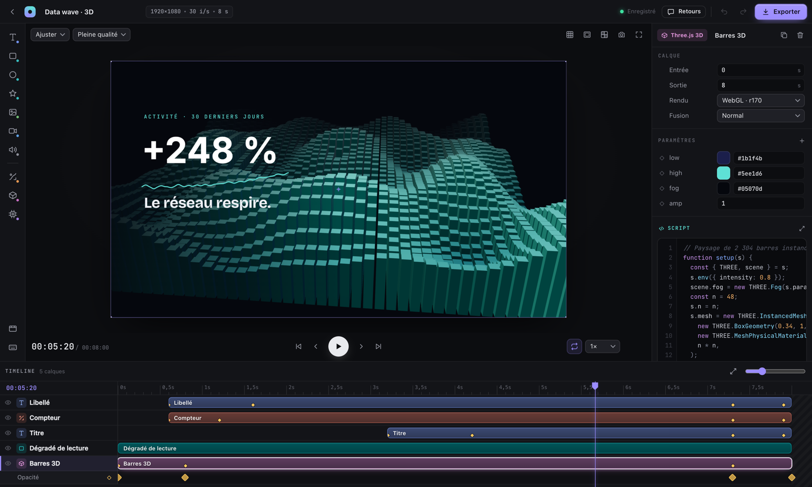
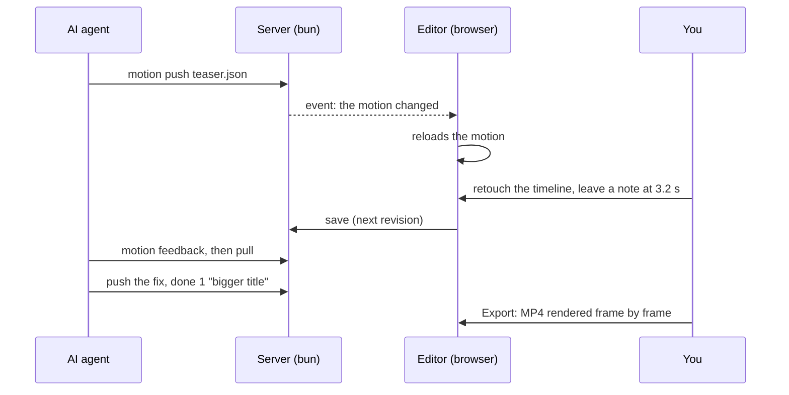

<div align="center">

[](README.md)


# Motion Studio

**A motion design editor in the browser that your AI agent can write.**<br>
The agent writes the animation as JSON, you retouch it by hand on a real timeline, you export the video to MP4. Nothing to install, no cloud.

[](LICENSE)
[](https://bun.sh)
[](https://threejs.org)
[](#how-it-works)
[](server.ts)

</div>

<p align="center"></p>

## Why

Asking an AI for an animation usually gives you a frozen video: if a title is too small or lands half a second early, you have to ask for the whole thing again. Classic editors, on the other hand, cannot be driven by an agent.

Motion Studio sits in between. A motion is a single JSON document that the agent writes and pushes. It opens in a full editor where you fix what is off yourself, and you leave the agent notes pinned to the exact instant that bothers you.

## How it works



- **A real timeline.** Keyframes, easing curves, an inspector, text, shape, image, video and sound layers.
- **3D when it helps.** Script layers run in Canvas 2D or Three.js (WebGL r170, WebGPU r187 with TSL), with optional ambient occlusion, depth of field, bloom and motion blur. They run in a sandboxed iframe with no access to the app.
- **A reliable export.** The video is encoded frame by frame with WebCodecs (H.264 and AAC in an MP4), so it stays smooth even on a slow machine. WebM and PNG too.
- **Built for agents.** The format is documented to be written by hand or by a model ([docs/format.md](docs/format.md), in French), every write bumps a revision, and an open editor reloads as soon as a script pushes.

## Requirements

- [Bun](https://bun.sh).
- A Chromium-based browser (Chrome, Brave, Edge, Arc) for the WebCodecs export. Safari and Firefox open the editor but export with real-time recording.

## Install

```sh
git clone https://github.com/pyxl-dev/motion-studio
cd motion-studio
bun server.ts
```

Open http://127.0.0.1:5317 and start from one of the gallery templates. Nothing else to install: the server has no dependencies.

### Let your AI agent do it

Paste this into Claude Code, Codex, Cursor or any agent with a terminal:

```text
Clone https://github.com/pyxl-dev/motion-studio, run `bun server.ts` in the background,
read docs/format.md, then make me an 8 s 16:9 teaser about <your topic>.
Push it with `bun tools/motion.ts push` and give me the editor link.
When I say "check my notes", read `bun tools/motion.ts feedback`.
```

## The CLI

```sh
bun tools/motion.ts push teaser.json teaser     # create or replace, prints the editor link
bun tools/motion.ts pull teaser teaser.json     # get the version retouched in the editor
bun tools/motion.ts list                        # id, revision, author, name
bun tools/motion.ts media logo.png capture.png  # upload files, prints their /media/... paths
bun tools/motion.ts feedback                    # notes left in the editor, with the instant
bun tools/motion.ts done 3 "Bigger title"       # answer a note and mark it done
```

A `push` of a file that carries `rev` fails if the motion was retouched since: `pull` first, or `--force` to overwrite.

## Settings

| Variable | Role | Default |
| --- | --- | --- |
| `PORT` | server port | `5317` |
| `HOST` | listen address | `127.0.0.1` |
| `DATA_DIR` | folder for motions, media and notes | `./data` |
| `MOTION_STUDIO_URL` | server the CLI talks to | `http://127.0.0.1:5317` |
| `MOTION_AUTHOR` | author name the editor shows for CLI writes | `agent` |

For a sound library in the "Son et SFX" button, drop your files and an `index.json` in `DATA_DIR/sfx/`: the format is in [docs/format.md](docs/format.md). No sounds are shipped.

## Security

- The server has no authentication and listens on `127.0.0.1` only by default. Keep it local, or put an authenticated proxy in front.
- Everything stays with you: motions as JSON in `data/motions/`, media in `data/media/`, notes in `data/comments.json`.
- The only outgoing network call is the browser loading fonts from Google Fonts.
- Layer scripts run in a sandboxed iframe, with no access to the app's cookies or API.
- To report a vulnerability: [SECURITY.md](SECURITY.md).

## Development

```
server.ts              HTTP server and JSON API (Bun, no dependencies)
tools/motion.ts        CLI for scripts and agents
public/app.js          shell: router and the host helpers the editor uses
public/studio/         the editor: studio.js (UI), engine.js (compositor),
                       runtime.html (script sandbox), frames.js, video.js,
                       audio.js, templates.js
public/vendor/         three.js and mp4-muxer (see THIRD_PARTY.md)
docs/format.md         motion document format and script API
```

The interface is in French for now.

## License

[MIT](LICENSE). Third-party code: [THIRD_PARTY.md](THIRD_PARTY.md). Made with Claude.
