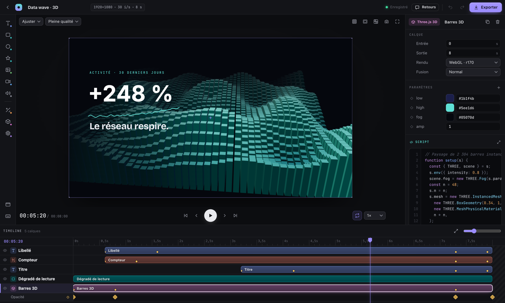
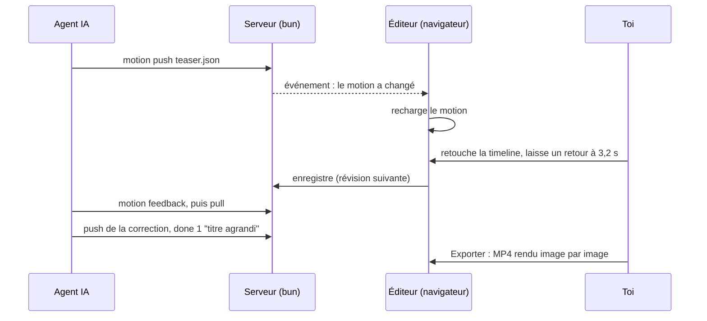

<div align="center">

[](README.en.md)


# Motion Studio

**Un éditeur de motion design dans le navigateur, que ton agent IA sait écrire.**<br>
L'agent écrit l'animation en JSON, tu la retouches à la main sur une vraie timeline, tu exportes la vidéo en MP4. Sans logiciel à installer, sans cloud.

[](LICENSE)
[](https://bun.sh)
[](https://threejs.org)
[](#comment-ça-marche)
[](server.ts)

</div>

<p align="center"></p>

## Pourquoi

Demander une animation à une IA donne en général une vidéo figée : si un titre est trop petit ou arrive une demi-seconde trop tôt, il faut tout redemander. Les éditeurs classiques, eux, ne se pilotent pas par un agent.

Motion Studio est entre les deux. Un motion est un seul document JSON que l'agent écrit et pousse. Il s'ouvre dans un éditeur complet où tu corriges toi-même ce qui ne va pas, et tu laisses à l'agent des retours épinglés à l'instant précis qui te gêne.

## Comment ça marche



- **Une vraie timeline.** Images clés, courbes d'accélération, inspecteur, calques de texte, formes, images, vidéos et sons.
- **De la 3D quand il en faut.** Les calques scriptés tournent en Canvas 2D ou en Three.js (WebGL r170, WebGPU r187 avec TSL), avec occlusion ambiante, profondeur de champ, bloom et flou de mouvement en option. Ils s'exécutent dans un iframe isolé, sans accès à l'application.
- **Un export fiable.** La vidéo est encodée image par image avec WebCodecs (H.264 et AAC dans un MP4) : elle reste fluide même si la machine calcule lentement. WebM et PNG aussi.
- **Fait pour un agent.** Le format est documenté pour être écrit à la main ou par un modèle ([docs/format.md](docs/format.md)), chaque écriture incrémente une révision, et un éditeur ouvert se recharge dès qu'un script pousse.

## Prérequis

- [Bun](https://bun.sh).
- Un navigateur basé sur Chromium (Chrome, Brave, Edge, Arc) pour l'export WebCodecs. Safari et Firefox ouvrent l'éditeur mais exportent en enregistrement temps réel.

## Installation

```sh
git clone https://github.com/pyxl-dev/motion-studio
cd motion-studio
bun server.ts
```

Ouvre http://127.0.0.1:5317, pars d'un des modèles de la galerie. Rien à installer d'autre : le serveur n'a aucune dépendance.

### Laisse ton agent IA s'en occuper

Colle ceci dans Claude Code, Codex, Cursor ou n'importe quel agent qui a accès à un terminal :

```text
Clone https://github.com/pyxl-dev/motion-studio, lance `bun server.ts` en arrière-plan,
lis docs/format.md, puis fais-moi un teaser de 8 s en 16:9 sur <ton sujet>.
Pousse-le avec `bun tools/motion.ts push` et donne-moi le lien de l'éditeur.
Quand je te dis « regarde mes retours », lis `bun tools/motion.ts feedback`.
```

## La CLI

```sh
bun tools/motion.ts push teaser.json teaser     # crée ou remplace, affiche le lien de l'éditeur
bun tools/motion.ts pull teaser teaser.json     # récupère la version retouchée dans l'éditeur
bun tools/motion.ts list                        # id, révision, auteur, nom
bun tools/motion.ts media logo.png capture.png  # envoie des fichiers, affiche leurs chemins /media/...
bun tools/motion.ts feedback                    # retours laissés dans l'éditeur, avec l'instant
bun tools/motion.ts done 3 "Titre agrandi"      # répond à un retour et le marque fait
```

Un `push` d'un fichier qui porte `rev` échoue si le motion a été retouché depuis : `pull` d'abord, ou `--force` pour écraser.

## Réglages

| Variable | Rôle | Défaut |
| --- | --- | --- |
| `PORT` | port du serveur | `5317` |
| `HOST` | adresse d'écoute | `127.0.0.1` |
| `DATA_DIR` | dossier des motions, médias et retours | `./data` |
| `MOTION_STUDIO_URL` | serveur visé par la CLI | `http://127.0.0.1:5317` |
| `MOTION_AUTHOR` | nom de l'auteur affiché dans l'éditeur pour les écritures de la CLI | `agent` |

Pour une bibliothèque de sons dans le bouton « Son et SFX », dépose tes fichiers et un `index.json` dans `DATA_DIR/sfx/` : le format est décrit dans [docs/format.md](docs/format.md). Aucun son n'est fourni.

## Sécurité

- Le serveur n'a pas d'authentification et n'écoute que sur `127.0.0.1` par défaut. Garde-le en local, ou mets un proxy authentifié devant.
- Tout reste chez toi : motions en JSON dans `data/motions/`, médias dans `data/media/`, retours dans `data/comments.json`.
- Le seul appel réseau sortant est le chargement des polices depuis Google Fonts dans le navigateur.
- Les scripts des calques tournent dans un iframe isolé, sans accès aux cookies ni à l'API de l'application.
- Pour signaler une faille : [SECURITY.md](SECURITY.md).

## Développement

```
server.ts              serveur HTTP et API JSON (Bun, aucune dépendance)
tools/motion.ts        CLI pour les scripts et les agents
public/app.js          coquille : routeur et fonctions hôtes de l'éditeur
public/studio/         l'éditeur : studio.js (interface), engine.js (compositeur),
                       runtime.html (bac à sable des scripts), frames.js, video.js,
                       audio.js, templates.js
public/vendor/         three.js et mp4-muxer (voir THIRD_PARTY.md)
docs/format.md         format des motions et API des scripts
```

L'interface est en français pour l'instant.

## Licence

[MIT](LICENSE). Code tiers : [THIRD_PARTY.md](THIRD_PARTY.md). Créé avec Claude.
